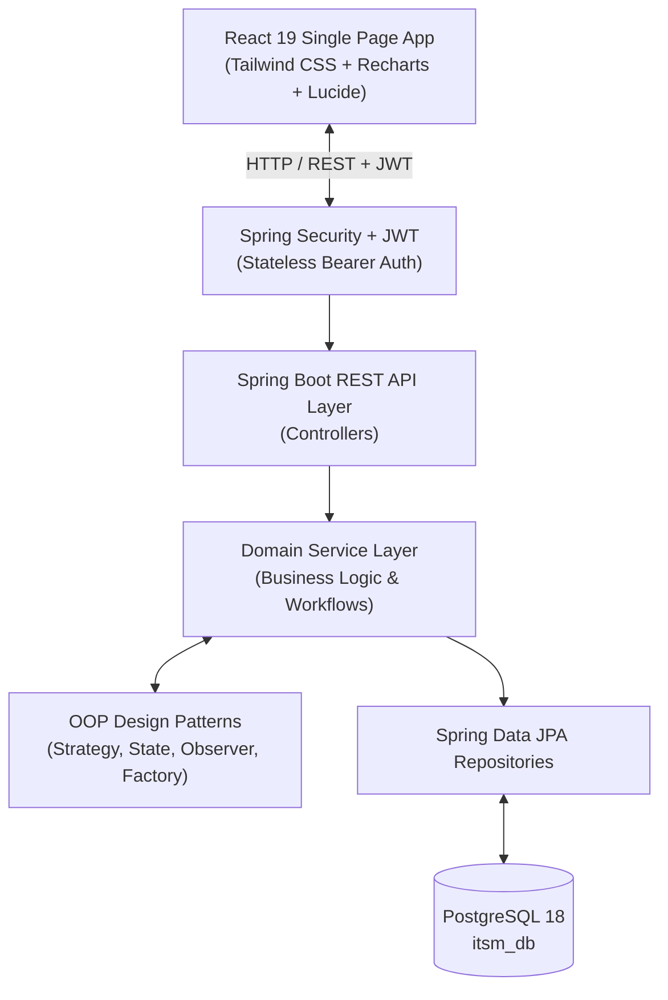

# Intelligent IT Service Management & Incident Resolution System (I-ITSM)

**CS F213 / MAC F212 — Object-Oriented Programming (OOP) Semester Project**

A complete, enterprise-grade full-stack Intelligent IT Service Management (ITSM) and Incident Resolution platform built with **Java 21 / Spring Boot 4**, **PostgreSQL 18**, and **React 19 / Vite / Tailwind CSS**.

---

## 🏛️ System Architecture



---

## 🧩 Object-Oriented Design Patterns

| Pattern | Component | Purpose & Demonstration |
| :--- | :--- | :--- |
| **Strategy Pattern** | `PriorityCalculationStrategy`<br/>`DefaultPriorityStrategy`<br/>`WeightedPriorityStrategy` | Interchangeable prioritization algorithms calculating severity based on Impact, Urgency, and Business Criticality without altering core services. |
| **Strategy Pattern** | `AssignmentStrategy`<br/>`SkillBasedAssignmentStrategy`<br/>`LoadBasedAssignmentStrategy` | Dynamically selects suitable support engineers based on category skill matching or active queue load balancing. |
| **State Pattern** | Incident Lifecycle Manager | Enforces legal lifecycle progression (`NEW` → `CLASSIFIED` → `ASSIGNED` → `ACKNOWLEDGED` → `IN_PROGRESS` → `RESOLVED` → `VERIFIED` → `CLOSED`) preventing illegal skips. |
| **Observer Pattern** | `NotificationService` | Broadcasts lifecycle events across simulated channels (in-app, email, SMS) to reporters and on-call technicians upon state changes. |
| **Repository Pattern** | `IncidentRepository`, `UserRepository`, etc. | Decouples domain business layer from low-level relational PostgreSQL persistence queries. |

---

## 🧠 Intelligent & Automated Capabilities

1. **Jaccard Word-Similarity Duplicate Incident Detection**: Automatically parses token frequencies across active open incidents to warn technicians and employees against duplicate ticket submissions.
2. **Dynamic Workload-Aware Assignment Recommendation**: Automatically evaluates technician active load and specialization to assign tickets to the engineer with the lowest active backlog.
3. **Automated SLA Deadline & Violation Detection Engine**: Calculates response deadlines and resolution target timestamps based on service criticality and priority policies.

---

## 👥 Pre-Configured Demo Credentials

The database automatically initializes with sample users and realistic domain data on first startup:

| Role | Username | Password | Purpose |
| :--- | :--- | :--- | :--- |
| **Administrator** | `admin` | `admin123` | Full access to user profiles, IT service catalog, SLA policies, and security audit logs |
| **Technician (Network/Security)** | `tech_network` | `tech123` | Assigned to network, security, and hardware incidents |
| **Technician (Database/Cloud)** | `tech_db` | `tech123` | Assigned to database, cloud storage, and infrastructure incidents |
| **Technician (Applications)** | `tech_app` | `tech123` | Assigned to web apps, APIs, and authentication incidents |
| **Employee** | `emp_john` | `emp123` | Reports incidents, tracks progress, submits 5-star resolution feedback |
| **Employee** | `emp_sarah` | `emp123` | Reports incidents and collaborates with technicians |

---

## 🚀 Quick Start Guide

### Option A: Run with Docker (Recommended for Evaluators)
Run the entire platform (PostgreSQL database, Spring Boot backend, and React frontend) with a single command:
```bash
docker compose up --build
```
- **Web App**: Open [http://localhost:3000](http://localhost:3000)
- **API Endpoint**: [http://localhost:8080/api](http://localhost:8080/api)

---

### Option B: Run Locally on Host Machine

#### 1. Prerequisites
- **Java JDK 21+**
- **PostgreSQL** (Service running on default port `5432` with database `itsm_db`)
- **Node.js v20+ & npm**

#### 2. Run the Spring Boot Backend
```powershell
cd backend
.\mvnw.cmd spring-boot:run
```
*Backend runs on `http://localhost:8080`.*

#### 3. Run the React Frontend
```powershell
cd frontend
npm run dev
```
*Frontend runs on `http://localhost:5173`.*

#### 4. Execute the Test Suite (17 Automated Tests)
```powershell
cd backend
.\mvnw.cmd test '-Dtest=StrategyPatternTests,IncidentServiceTests'
```

---

## 📊 Verification & Test Coverage Summary

- ✅ **8 Strategy Pattern Tests**: Validates boundary scores for P1/P2/P3/P4, skill matching, fallback behavior, and load tie-breaking.
- ✅ **9 Incident Service Lifecycle Tests**: Validates SLA deadline calculation, invalid transition rejection (`InvalidStateTransitionException`), technician acknowledgment timing, workload decrement upon resolution, duplicate detection, and star rating feedback.
- **Total Tests**: **17 passed**, 0 failures, 0 errors.
